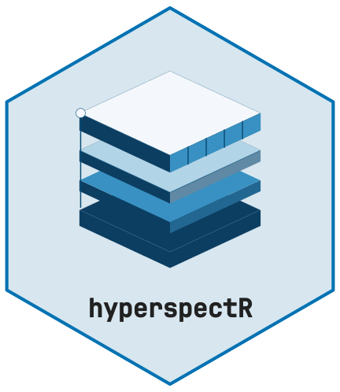

# Research Oxygenation Model Workflow



[](https://github.com/CTTIR/hyperspectR/actions/workflows/R-CMD-check.yaml)
[](https://cttir.github.io/hyperspectR/)
[](https://app.codecov.io/gh/CTTIR/hyperspectR?branch=main)
[](https://opensource.org/licenses/MIT)
[](https://lifecycle.r-lib.org/articles/stages.html#experimental)

``` r

library(hyperspectR)
#> hyperspectR v0.3.0 - Hyperspectral Imaging Analysis for Biomedical Applications
```

## Overview

This vignette demonstrates a research processing workflow on a synthetic
scene. The simulator is not a tissue measurement or an independent
validation dataset. No surgical decision or diagnostic threshold follows
from these examples.

## Step 1: Load Data

``` r

cube <- hs_simulate_cube(rows = 50, cols = 50, n_regions = 4,
                          sto2_range = c(0.2, 0.95), seed = 42)
print(cube)
#> 
#> ── hsi_cube ────────────────────────────────────────────────────────────────────
#> Dimensions: 50 rows x 50 cols x 61 bands
#> Wavelengths: 430-910 nm (61 bands)
#> FWHM: 25 nm (mean)
#> Mask: 2500/2500 valid pixels (100%)
#> Data range: [0.0163, 0.734]
#> Metadata: camera, spectral_model, interpretation, processing_mode,
#> acquisition_time, region_map, sto2_ground_truth, seed
```

## Step 2: Preprocessing

``` r

smoothed <- hs_smooth(cube, window = 7, poly = 3)
hs_plot_spectra(smoothed)
```


## Step 3: Dimensionless Band Ratio

``` r

sto2_ratio <- hs_band_ratio(smoothed, c(700, 800), c(500, 650))
hs_plot_index(sto2_ratio, title = "Relative NIR/visible ratio", palette = "sto2")
```


## Step 4: Beer-Lambert Chromophore Fitting

``` r

fit <- hs_beer_lambert(smoothed)
hs_plot_index(fit$sto2, title = "Fitted Hb fraction (%)", palette = "sto2")
```


## Step 5: ROI-Based Statistical Analysis

``` r

# Define ROIs for different surgical field regions
roi_healthy <- hs_roi_rect(smoothed, x_range = c(1, 20), y_range = c(1, 20))
roi_ischemic <- hs_roi_rect(smoothed, x_range = c(30, 50), y_range = c(1, 20))

stats_healthy <- hs_roi_stats(smoothed, roi_healthy)
stats_ischemic <- hs_roi_stats(smoothed, roi_ischemic)

library(ggplot2)
ggplot() +
  geom_ribbon(data = stats_healthy,
              aes(x = wavelength, ymin = mean - sd, ymax = mean + sd),
              fill = "#2E86AB", alpha = 0.3) +
  geom_line(data = stats_healthy,
            aes(x = wavelength, y = mean, color = "Region 1"), linewidth = 0.8) +
  geom_ribbon(data = stats_ischemic,
              aes(x = wavelength, ymin = mean - sd, ymax = mean + sd),
              fill = "#E41A1C", alpha = 0.3) +
  geom_line(data = stats_ischemic,
            aes(x = wavelength, y = mean, color = "Region 2"), linewidth = 0.8) +
  scale_color_manual(values = c("Region 1" = "#2E86AB", "Region 2" = "#E41A1C")) +
  labs(x = "Wavelength (nm)", y = "Reflectance",
       title = "ROI Spectral Comparison", color = "") +
  theme_hsi()
```


## Step 6: Research Panel

``` r

hs_plot_clinical(smoothed)
#> Warning: ! Wavelength range (454-886 nm) does not fully cover NPI requirements (655-910
#>   nm).
#> ℹ Results may be approximate.
```


## Step 7: PCA for Quality Assessment

``` r

pca <- hs_pca(smoothed, n_components = 3)
cat("Variance explained:", round(pca$variance_explained * 100, 1), "%\n")
#> Variance explained: 83.7 1.2 1 %
```
